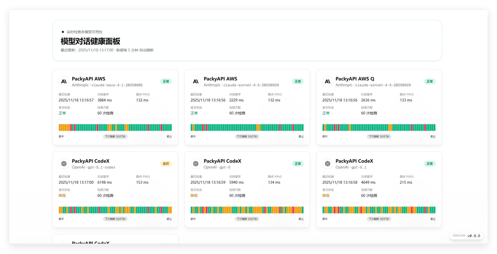

# Check CX

Check CX 是一个基于 vinext、Vercel 与 Supabase 的 AI 模型 API 可用性与延迟监控面板。健康检查由 Supabase 持久队列驱动，并提供可视化 Dashboard 与只读状态 API。



## 功能概览

- 统一的 Provider 健康检查（OpenAI / Gemini / Anthropic），支持 Chat Completions 与 Responses 端点
- 实时延迟、Ping 延迟与历史时间线，支持 7/15/30 天可用性统计
- 分组视图与分组详情页（`group_name` + `group_info`），支持分组标签与官网链接
- 维护模式与系统通知横幅（支持 Markdown，多条轮播）
- 官方状态检查（当前支持 OpenAI 与 Anthropic）
- 多节点部署自动选主（数据库租约避免并发触发重复执行）
- 安全默认：模型密钥仅保存在数据库，服务端使用 service role key 读取

## 快速开始

### 1. 环境准备

- Node.js 22.12 及以上（用于本地 Vite/vinext 工具链）
- pnpm 10
- Supabase 项目（PostgreSQL）
- Vercel 项目

### 2. 安装依赖

```bash
pnpm install
```

### 3. 配置环境变量

```bash
cp .env.example .env.local
```

填写 `.env.local`：

```env
SUPABASE_URL=...
SUPABASE_PUBLISHABLE_OR_ANON_KEY=...
SUPABASE_SERVICE_ROLE_KEY=...
CHECK_NODE_ID=local
CHECK_POLL_INTERVAL_SECONDS=60
HISTORY_RETENTION_DAYS=30
OFFICIAL_STATUS_CHECK_INTERVAL_SECONDS=300
CHECK_CONCURRENCY=5
```

### 4. 初始化数据库

- 全新项目：执行 `supabase/schema.sql`（如需开发 schema，请执行 `supabase/schema-dev.sql`）。
- 已存在数据库：按顺序执行 `supabase/migrations/` 目录中的迁移文件；如使用 dev schema，同步执行 `*_dev.sql` 迁移。

### 5. 添加最小配置

```sql
INSERT INTO check_configs (name, type, model, endpoint, api_key, enabled)
VALUES ('OpenAI GPT-4o',
        'openai',
        'gpt-4o-mini',
        'https://api.openai.com/v1/chat/completions',
        'sk-your-api-key',
        true);
```

### 6. 启动开发服务器

```bash
pnpm dev
```

访问 http://localhost:3000 查看 Dashboard。

## 运行与部署

```bash
pnpm dev       # 本地 Vite/vinext 开发
pnpm check     # vinext 兼容性检查
pnpm lint      # 代码检查
```

将 Git 仓库导入 Vercel，配置 `.env.example` 中必需的 Supabase 服务端变量后部署。Vercel 使用 Nitro preset 输出应用；检测运行在数据库持久队列中，每次函数调用只处理有限任务，后续由下一次调度继续。

生产数据库迁移、Vercel 环境变量、Supabase 每分钟 Cron 和回滚流程见 [`docs/VERCEL-DEPLOYMENT.md`](docs/VERCEL-DEPLOYMENT.md)。不要使用 Vercel Hobby Cron 代替每分钟调度。

## 配置说明

### 环境变量

| 变量                                       | 必需 | 默认值     | 说明                          |
|------------------------------------------|----|---------|-----------------------------|
| `SUPABASE_URL`                           | 是  | -       | Supabase 项目 URL             |
| `SUPABASE_PUBLISHABLE_OR_ANON_KEY`       | 是  | -       | Supabase 公共访问 Key           |
| `SUPABASE_SERVICE_ROLE_KEY`              | 是  | -       | Service Role Key（服务端使用，勿暴露） |
| `CHECK_NODE_ID`                          | 否  | `local` | 节点身份，用于多节点选主                |
| `CHECK_POLL_INTERVAL_SECONDS`            | 否  | `60`    | 检测间隔（15–600 秒）              |
| `CHECK_CONCURRENCY`                      | 否  | `5`     | 最大并发（1–20）                  |
| `OFFICIAL_STATUS_CHECK_INTERVAL_SECONDS` | 否  | `300`   | 官方状态轮询间隔（60–3600 秒）         |
| `HISTORY_RETENTION_DAYS`                 | 否  | `30`    | 历史保留天数（7–365）               |

### Provider 配置要点

- `check_configs.type` 目前支持 `openai` / `gemini` / `anthropic`。
- `endpoint` 必须是完整端点：
    - `/v1/chat/completions` 使用 Chat Completions
    - `/v1/responses` 使用 Responses API
- `request_header` 与 `metadata` 允许注入自定义请求头与请求体参数。
- `is_maintenance = true` 会保留卡片但停止轮询；`enabled = false` 则完全不纳入检测。

## API 概览

- `GET /api/dashboard?trendPeriod=7d|15d|30d`：Dashboard 聚合数据（带 ETag）。返回完整时间线与可用性统计。
- `GET /api/group/[groupName]?trendPeriod=7d|15d|30d`：分组详情数据。
- `GET /api/v1/status?group=...&model=...`：对外只读状态 API。

更详细的接口与数据结构见文档。

## 文档

- 架构说明：`docs/ARCHITECTURE.md`
- 运维手册：`docs/OPERATIONS.md`
- Vercel 部署与持久检测队列：`docs/VERCEL-DEPLOYMENT.md`
- Provider 扩展：`docs/EXTENDING_PROVIDERS.md`

## 许可证

[MIT](LICENSE)
